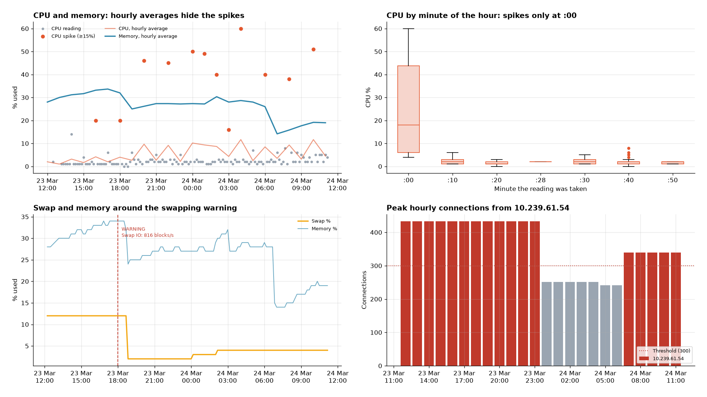
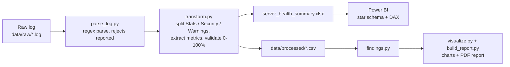
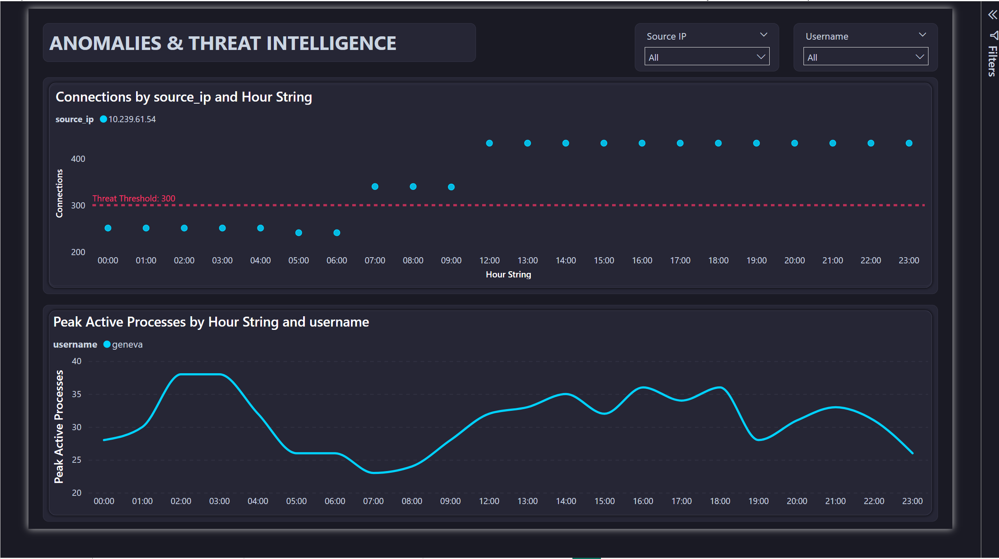

# Server Health Analytics

A raw server-monitoring log, parsed into analysis-ready tables in Python. The tables feed an automated PDF report and a 3-page Power BI drill-through dashboard. Built as freelance work: the client wanted a dashboard that proves what their monitoring data can show, ahead of moving the logs into Snowflake.



## Pipeline



```bash
pip install -r requirements.txt
python run_pipeline.py
```

## What the data shows

The source is one 24-hour log (539 lines), and every line parsed.

- **CPU load comes in scheduled bursts.** All 12 readings of 15% or more were taken at minute :00. Those readings average 24.5%, against 2.0% for every other reading, which is the signature of a cron-style job. Hourly averaging flattens a 60% peak to 11.7%, so the dashboard's "Daily Peak CPU" card understates peak load by about 5x. The fix is to compute the peak from raw readings.
- **The swapping warning resolved itself.** 50 minutes after the 18:00 warning, swap fell from 12% to 2% and memory from 34% to 24% in the same reading.
- **One internal IP (10.239.61.54) held 300+ connections in 17 of 24 hours.** A private address at that volume is more likely a service, such as a load balancer or connection pool, than an attack.
- **User processes don't explain the CPU.** The correlation is r = −0.08. This corrects the client deliverable's first draft, which blamed user `geneva`.

Full write-up with charts: [reports/Server_Health_Report.pdf](reports/Server_Health_Report.pdf).

## Power BI dashboard

The dashboard uses Calendar and Hour dimensions, so more days of logs can be appended without changes. The DAX measures and build steps are in [docs/](docs/).

| Executive command center | Anomalies & threats | Diagnostic root cause |
|---|---|---|
|  |  |  |
