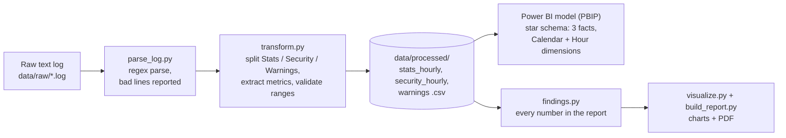
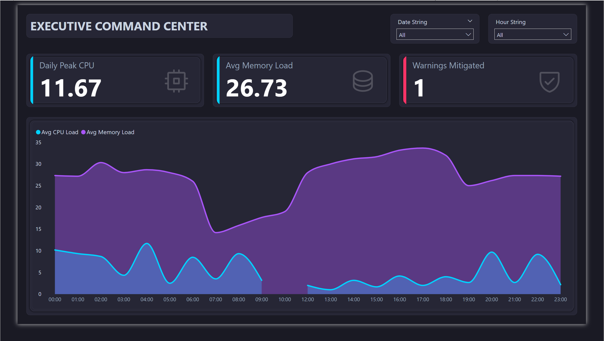
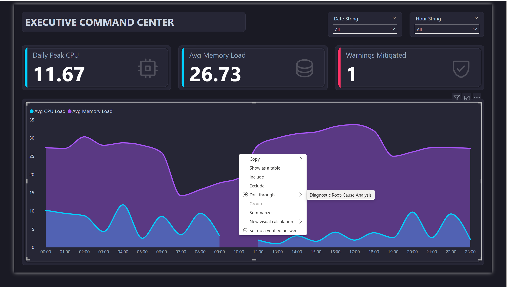
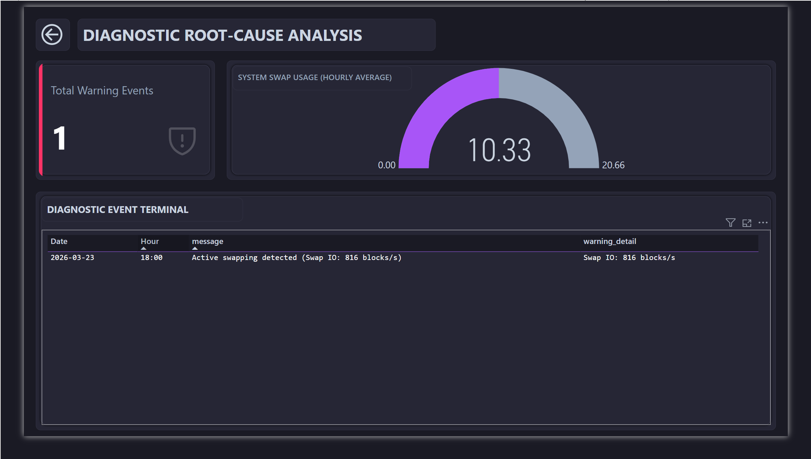

# Server Health Analytics

This project turns a raw, unstructured server-monitoring log into analysis-ready tables with a Python pipeline. The tables feed an automated PDF report and a 3-page Power BI drill-through dashboard, which is version-controlled as a Power BI Project (PBIP).

Built as freelance work. The client wanted to show what their monitoring data could reveal before moving the logs into Snowflake. The deliverable had to work on one day of data and keep working, unchanged, as more days arrive.


## Pipeline



```bash
pip install -r requirements.txt
python run_pipeline.py        # parse -> transform -> findings -> charts -> PDF
pytest                        # requires requirements-dev.txt
```

## What the data shows

The source is one day of logs (23 Mar 12:13 to 24 Mar 11:10), 539 lines, and every line parsed.

- **CPU load comes in scheduled bursts.** All 12 readings of 15% or more were taken at minute :00, and each burst lasts a single 10-minute reading. On-the-hour readings average 24.5%, against 2.0% for every other reading: the signature of a cron-style job. The bursts land every two hours from 16:00, and every hour between 00:00 and 04:00.
- **Averages hid the peak.** Hourly averaging flattens a 60% reading to 11.7%. The dashboard's *Daily Peak CPU* card originally showed 11.67% for this reason. I fixed it after delivery: the pipeline now keeps each hour's highest reading, and the measure reads that.
- **The swapping warning resolved itself.** 50 minutes after the 18:00 warning, swap fell from 12% to 2% and memory from 34% to 24% in the same reading.
- **One internal IP (10.239.61.54) held 300+ connections in 17 of 24 hours.** A private address at that volume is more likely a service, such as a load balancer or connection pool, than an attack. The next step is to identify that host and set its expected baseline.
- **User processes don't explain the CPU.** The first draft of the client report blamed user `geneva`. The data says otherwise. The user's process count peaked at 38 at 02:40, when CPU read 2%. At the day's CPU peak (60% at 04:00), the count had already fallen to 32. Across all hours the two are uncorrelated however CPU is summarised: r = −0.08 against the hourly average, and r = 0.05 against the hourly peak.

Full write-up with charts: [reports/Server_Health_Report.pdf](reports/Server_Health_Report.pdf).

## Power BI dashboard

The model is a star schema: three fact tables joined to `Dim_Calendar` and `Dim_Time` on date and hour. One slicer, or a drill-through on any hour, therefore filters CPU, security events and warnings together, and the date slicer grows with the data. Because the report is saved as a PBIP, the whole model can be read on GitHub: [tables and measures](powerbi/Server_analysis_report.SemanticModel/definition/tables/), [relationships](powerbi/Server_analysis_report.SemanticModel/definition/relationships.tmdl).

To open it, see [docs/power-bi.md](docs/power-bi.md), which covers the `DataFolder` parameter, the model diagram, every measure, and the KPIs with the decisions each one supports.

The report has three pages. The drill-through is an interaction, not a fourth page: right-click any hour on a page 1 or page 2 chart to open page 3 filtered to that hour.

| Page 1: Executive Command Center | Page 2: Anomalies & Threat Intelligence |
|---|---|
|  |  |
| **Page 1: right-click an hour → Drill through** | **Page 3: Diagnostic Root-Cause Analysis (drill-through target)** |
|  |  |

*The screenshots were taken before the Daily Peak CPU fix, so that card still reads 11.67.*

## Project structure

```
data/raw/            the source log
src/parse_log.py     raw text -> event table (timestamp, type, message)
src/transform.py     event table -> fact tables; the CSV names and columns are the Power BI contract
src/findings.py      computes every figure quoted in the report
src/visualize.py     charts (one function per chart, reused for the overview grid)
src/build_report.py  PDF report
powerbi/             PBIP: semantic model (TMDL) + report definition, and screenshots
tests/               parsing, extraction, the Power BI file contract, and the findings on the real log
```

## Design choices

- **Bad input is reported, never silently dropped.** Unparseable log lines and unrecognised messages are counted and printed, and impossible percentages stop the run.
- **The report can't drift from the data.** All numbers in the PDF come from `findings.py`. Re-running the pipeline on a new log rewrites the narrative with new figures.
- **The pipeline and the dashboard are covered by a test.** Power BI loads the processed CSVs by file name and column name, and a test fails if `transform.py` changes either one.
