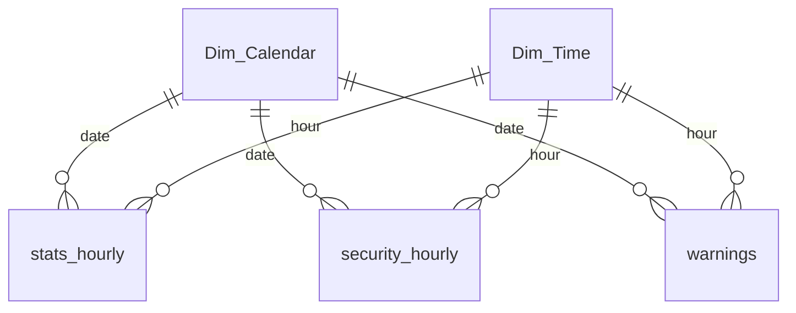

# Power BI report

The report is saved as a **Power BI Project** (`powerbi/Server_analysis_report.pbip`). In this format the model is stored as TMDL text files and the report as JSON, so every measure and visual can be read and diffed on GitHub.

## Open and refresh it

1. Run the pipeline so `data/processed/` exists: `python run_pipeline.py`.
2. Open `powerbi/Server_analysis_report.pbip` in Power BI Desktop. This needs Windows and a recent Desktop version.
3. Go to **Transform data → Edit parameters** and set **DataFolder** to the full path of `data/processed/` on your machine, including the trailing `\`.
4. Click **Refresh**.

## Model

| Table | Source | Grain |
|---|---|---|
| `stats_hourly` | `stats_hourly.csv` | One row per hour: average CPU, memory and swap %, plus the hour's highest CPU reading (`cpu_peak_pct`) |
| `security_hourly` | `security_hourly.csv` | One row per security event: a user's process count, or an IP's connection count |
| `warnings` | `warnings.csv` | One row per system warning |
| `Dim_Calendar` | DAX `CALENDARAUTO()` | One row per date |
| `Dim_Time` | DAX `GENERATESERIES(0, 23)` | One row per hour of the day (`00:00` … `23:00`) |

The three fact tables join both dimensions on `date` and `hour`. That lets a single Date or Hour slicer, or a drill-through on an hour, filter all of them together. The calendar is built from the data, so loading more days of logs extends the date slicer with no model changes.

## Measures

All measures are in the `_Measures` table ([definition](../powerbi/Server_analysis_report.SemanticModel/definition/tables/_Measures.tmdl)).

| Folder | Measure | DAX |
|---|---|---|
| System load | Avg CPU Load | `AVERAGE(stats_hourly[cpu_pct])` |
| | Daily Peak CPU | `MAXX(KEEPFILTERS(VALUES(Dim_Calendar[Date])), CALCULATE(MAX(stats_hourly[cpu_peak_pct])))` |
| | Avg Memory Load | `AVERAGE(stats_hourly[memory_pct])` |
| | Avg Swap Usage | `AVERAGE(stats_hourly[swap_pct])` |
| Security & traffic | Peak Hourly Connections | `MAX(security_hourly[connection_count])` |
| | Peak Active Processes | `MAX(security_hourly[active_processes])` |
| | Unique IPs Monitored | `DISTINCTCOUNT(security_hourly[source_ip])` |
| Anomaly detection | Total Warning Events | `COUNTROWS(warnings)` |
| | Warnings Mitigated | `[Total Warning Events]`, or "0 (System Healthy)" when there are none |
| | Swap_Usage_Unfiltered | `[Avg Swap Usage]` ignoring the hour filter (defined but not used on any page yet) |

**A bug fixed after delivery:** "Daily Peak CPU" originally took the maximum of the *hourly averages*, so the card showed 11.67%. CPU on this server spikes for a single reading at the top of the hour, so the real peak reading was 60%. The pipeline now writes each hour's highest reading as `cpu_peak_pct`, and the measure reads that column. The screenshots in this repo were taken before the fix.

## Pages

| Page | What it shows |
|---|---|
| **Executive Command Center** | KPI cards (Daily Peak CPU, Avg Memory Load, Warnings) and CPU and memory by hour, with Date and Hour slicers |
| **Anomalies & Threat Intelligence** | Connections by source IP and hour against a 300-connection threshold line, and peak processes by user, with IP and user slicers |
| **Diagnostic Root-Cause Analysis** | Drill-through page, filtered on `Dim_Time[Hour String]`. Right-click any hour on a page 1 or page 2 chart and choose *Drill through*. It shows that hour's warning count, swap gauge and event log. |

There are three pages. The drill-through is the link from pages 1 and 2 into page 3, not a page of its own.

## KPIs and the decisions they support

| KPI | Question it answers | Decision |
|---|---|---|
| Peak vs average CPU | Is there headroom for a traffic spike? | Scale capacity before a campaign or launch, not after an outage |
| Connections per source IP | Is one source flooding the server? | Investigate that host, add rate limits or firewall rules |
| Warning count | How often does the server degrade? | Fix the cause during planned maintenance instead of in an incident |
| Out-of-hours load | What runs while nobody is using the system? | Audit scheduled jobs that cost compute but may not be needed |
